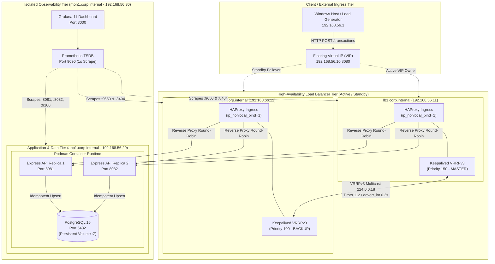

# High-Availability Cluster Architecture & Failover Sequence

This document details the production design, network paths, and protocol state transitions of the two-node RHEL load-balancer cluster.

---

## 1. Physical & Virtual Network Topology

All four virtual machines reside on an isolated VMware host-only virtual switch (`VMnet2`, `192.168.56.0/24`) with NAT egress for package downloads and security updates.



---

## 2. Failover Sequence Diagram (RFC 5798 Protocol Flow)

This sequence diagram illustrates the exact millisecond-by-millisecond mechanics during a catastrophic failure of the primary load balancer (`lb1`).

```mermaid
sequenceDiagram
    autonumber
    actor Client as Load Tester (Undici)
    participant VIP as Virtual IP (192.168.56.10)
    participant LB1 as lb1 (MASTER :150)
    participant LB2 as lb2 (BACKUP :100)
    participant App as app1 (API + PostgreSQL)

    Note over Client,App: STEADY-STATE: lb1 is MASTER; 200 req/s load distributed to app1
    Client->>VIP: POST /transactions (UUID-1)
    VIP->>LB1: Terminate TCP on lb1
    LB1->>App: Proxy to API Replica 1 (:8081)
    App-->>LB1: HTTP 201 Created (X-LB-Node: lb1)
    LB1-->>Client: HTTP 201 Created (Latency: 2ms)

    Note over LB1: T=0.000s: CATASTROPHIC FAILURE (lb1 Powered Off)
    Client->>VIP: POST /transactions (UUID-2)
    Note right of Client: TCP SYN hangs / times out on dead lb1

    Note over LB2: T=0.300s: Missed VRRP Advert #1
    Note over LB2: T=0.600s: Missed VRRP Advert #2
    Note over LB2: T=0.900s: Missed VRRP Advert #3
    Note over LB2: T=1.083s: Master_Down_Interval expires!

    LB2->>LB2: State Transition: BACKUP -> MASTER
    LB2->>LB2: Bind 192.168.56.10 to interface ens33
    LB2->>VIP: Broadcast 5x Gratuitous ARP (GARP) bursts
    Note over VIP,LB2: VMware vSwitch & Host ARP table updated to lb2 MAC

    Note over Client: T=1.100s: Client 500ms timeout triggers retry (UUID-2)
    Client->>VIP: RETRY POST /transactions (Same UUID-2)
    VIP->>LB2: Ingress routed to lb2 (HAProxy pre-bound via nonlocal_bind)
    LB2->>App: Proxy to API Replica 2 (:8082)
    App->>App: INSERT ON CONFLICT (idempotency_key) DO NOTHING
    App-->>LB2: HTTP 201 Created (X-LB-Node: lb2)
    LB2-->>Client: HTTP 201 Created (Latency: 1.09s including retry)

    Note over Client,App: RECOVERY COMPLETE: Zero dropped transactions. VIP owned by lb2.
```

---

## 3. High-Availability Ingress Mechanics

### Non-Local Socket Binding (`net.ipv4.ip_nonlocal_bind=1`)
Standard Linux kernels prohibit user-space daemons from binding to network addresses not currently configured on local network interfaces. 
- In this architecture, HAProxy on both nodes executes:
  ```haproxy
  bind 192.168.56.10:8080 name vip
  ```
- Because `net.ipv4.ip_nonlocal_bind=1` is enabled in `/etc/sysctl.d/99-haproxy-nonlocal.conf`, HAProxy on `lb2` boots and listens successfully on the VIP even while `lb2` is in VRRP `BACKUP` state.
- When `lb2` assumes the VIP, incoming TCP SYN packets are immediately accepted by HAProxy's existing listen socket with **zero daemon startup latency**.

### Two-Tier Health Tracking
Keepalived monitors HAProxy through `/usr/local/bin/check_haproxy.sh`:
1. **Process Liveness**: Verifies the `haproxy` PID is active in the process table.
2. **HTTP Socket Liveness**: Executes `curl -sf --max-time 1 http://127.0.0.1:8404/stats`.
3. If HAProxy stops answering HTTP requests within 1 second, the check script exits with code `1`, dropping `lb1`'s priority from `150` to `90`. Because `90 < 100` (`lb2` priority), `lb2` immediately takes over the VIP.
